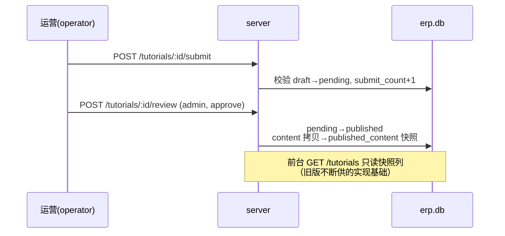
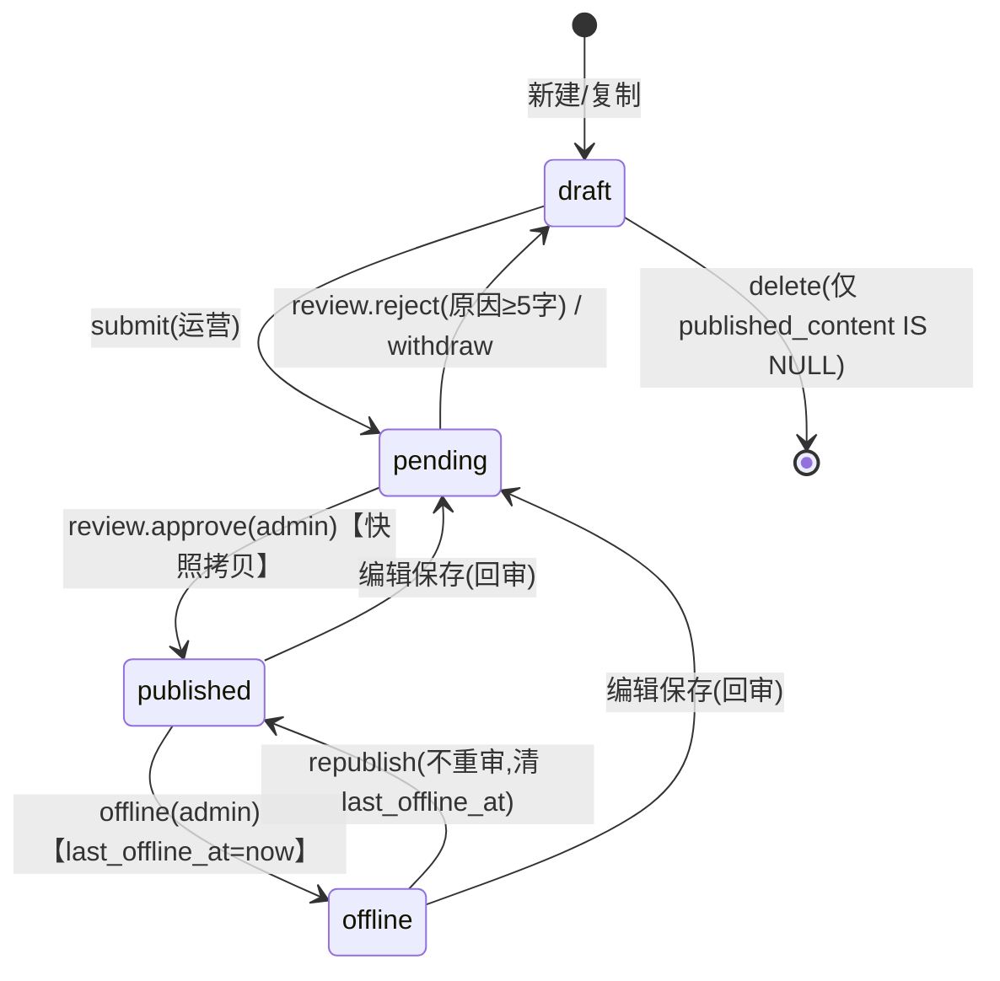

# 云ERP教程中心 · 技术方案

> 需求 RE00001 ｜ PRD v1.0（契约冻结）｜ 评审基线：docs/ac.md ｜ 版本 v1.0 ｜ 2026-08-21

## 1. 概述与目标

为云ERP教程中心（三端：PC 前台 / 管理后台 / 小程序 H5）提供可独立运行、可验收的全栈实现方案。核心闭环：运营创作→审核发布→三端分发→用户学习互动→数据回流看板→优化再生产（PRD §1A 契约）。

**技术选型（用户已确认）**：

| 层 | 选型 | 决策依据 |
|---|---|---|
| 前端 | React 18 + TypeScript + Vite 5 **多入口单工程**（portal.html / admin.html / m.html） | 三端共享类型与 API client；一次 install/build；开发热更 |
| 路由 | react-router-dom **HashRouter** | 多入口静态托管零 fallback 配置，直达/刷新安全 |
| 状态 | Context + hooks（登录态/角色一个 Context，页面数据自管） | demo 规模零依赖 |
| 后端 | Node.js 25 + Express 5 + TypeScript | 单体够用，前后端同语言同类型 |
| 数据库 | **node:sqlite**（内置 DatabaseSync，文件 server/erp.db） | 零原生依赖、单文件交付、可重复初始化（AC-NF-06） |
| 鉴权 | **DB token**：登录发随机 token 入库，前端 localStorage + Authorization 头，服务端查库 | 重启不丢会话、登出即作废，实现约 30 行 |
| 测试 | Playwright（@playwright/test，chromium） | 三端 E2E + API smoke，HTML 报告含截图（AC-OP-02） |

**部署形态**：`npm run build`（web→dist）→ `npm start`（Express 3000 托管 dist + /api）；开发态 Vite 5173 proxy `/api`→3000。

## 2. 现有代码基础与仓库结构

全新工程（无存量）。仓库 `zcode-demo-smt-yuanbo/`：

```
├── server/                  # Express + node:sqlite（端口 3000）
│   ├── src/index.ts         # 应用入口：静态托管 web/dist + /api 路由 + 鉴权中间件
│   ├── src/db.ts            # 建库（source design/sql/*.sql）+ 种子 + reset
│   ├── src/auth.ts          # token 签发/校验中间件（DB token）
│   ├── src/routes/          # auth.ts categories.ts tutorials.ts favorites.ts histories.ts feedbacks.ts stats.ts system.ts（reset） misc.ts（recommend/messages/checkins）
│   └── erp.db               # 运行时生成（.gitignore）
├── web/                     # Vite 多入口 React18+TS
│   ├── portal.html / admin.html / m.html
│   ├── vite.config.ts       # input 三入口 + proxy /api→3000
│   └── src/
│       ├── shared/          # api.ts（fetch 封装+token 注入）/ types.ts（与 DB 实体对齐）/ AuthContext.tsx / constants.ts（分类/模块映射/角色）
│       ├── portal/          # App.tsx（HashRouter）+ pages/{Home,List,Detail,My,Workbench}.tsx + components/{TutorialCard,RoleLoginModal,ShareModal…}
│       ├── admin/           # App.tsx + pages/{Login,Dashboard,TutorialList,TutorialEdit,Review,Category}.tsx + components/{Sidebar,RichEditor,StatBar…}
│       └── m/               # App.tsx + pages/{Home,List,Detail,Favorite,Checkin}.tsx + components/PhoneShell.tsx
├── tests/                   # Playwright：portal.spec.ts admin.spec.ts m.spec.ts api.spec.ts + playwright.config.ts
├── docs/                    # 本方案与需求产物（PRD/AC/UI/设计）
├── playwright-report/       # HTML 报告（交付物）
├── README.md / 开发总结与思考.md
```

## 3. API 接口（总览）

资源制 REST，`/api` 前缀，JSON，统一响应 `{code, message, data}`（0/401/403/404/409）。鉴权：`Authorization: Bearer {token}`。**明细文档见 `design/api/`（35 端点，35 个 .md；含 share 打点）。**

| 分组 | 端点数 | 说明 |
|---|---|---|
| 认证 | 4 | login / role-login / logout / me |
| 分类 | 4 | 树（含角标计数）/ 增 / 改（含模块映射）/ 删（409 删除保护） |
| 教程 | 13 | 列表（公开可见池/管理全态）/ 详情（快照+上下篇+关联+浏览计数；**?all=1 管理口径**返回当前编辑值，编辑器与审核卡片取数用，CHANGE-7/10）/ 增 / 改（回审）/ 删（纯草稿保护）/ 提审 / 撤回 / 审核（approve+快照拷贝 / reject+原因）/ 下架 / 重新发布 / 复制 / 置顶排序 / share 打点 |
| 用户行为 | 5 | favorites 增删查 ×3、histories upsert + 列表 ×2 |
| 反馈 | 1 | 评价 upsert（计数联动） |
| 统计 | 3 | overview（4 指标+Top10）/ feedback（占比倒序+留言）/ coverage（矩阵+模块聚合） |
| 联动 | 3 | recommend（角色映射 Top6，角色解析优先级：query erpRole > Bearer token > global，CHANGE-6）/ messages（mock 消息）/ checkins（打卡+状态 ×2 计 2） |
| 系统 | 1 | reset 重置种子（admin） |

## 4. 后端架构与处理流程

分层：routes（参数校验/鉴权/编排）→ service（纯函数业务规则，文件内按领域组织）→ db（DatabaseSync prepared statements）。无 ORM（node:sqlite 直 SQL，prepared 防注入；富文本 content 渲染端做脚本剥离——AC-NF-04）。

**核心链路 1：审核发布（状态机写入方唯一）**



**核心链路 2：前台可见性（PRD §6 规则的 SQL 化）**

```
可见 = published_content IS NOT NULL
     AND (status = 'published' OR (status IN ('pending','draft') AND last_offline_at IS NULL))
```
覆盖：①已发布可见 ②回审等待/驳回/撤回旧版在线 ③已下架不可见 ④已下架来源的回审期间不可见 ⑤从未过审不可见。列表/搜索/详情/推荐/首页区块/小程序**共用同一 WHERE 片段**（db.ts 导出 `VISIBLE_SQL`），杜绝口径漂移（AC 评审轮 3 的教训固化）。VISIBLE_SQL 常量由 db.ts（IT-01/INFRA-03）独占定义导出，其余模块仅 import 消费（CHANGE-1）；公开列表/详情的 summary 统一取 `COALESCE(published_summary, summary)`——无回审快照的教程回退工作列，favorites/histories/recommend/related 同口径（CHANGE-3）。

**核心链路 3：跨端收藏/进度**：favorites/histories 联合主键表三端同写同读，进度单值覆盖（AC-RULE-11），无需同步机制。

**状态机**（与 PRD §3.5 一致，`last_offline_at` 落地规则④）：



非法迁移一律 409（中间件按当前 status 校验动作合法性，AC-EG-09）。

## 5. 数据库设计

见 `design/db/db.md`（9 表 DDL + 可见性快照设计 + 规范偏差说明）与 `design/sql/*.sql`（幂等建表脚本，db.ts 直接执行）。

## 6. 异常处理与校验

| 场景 | 处理 | 前端提示 |
|---|---|---|
| 未登录调互动接口 | 401 | 弹选角色登录，登录后回原位（AC-FN-03） |
| operator 调审核/发布/下架/分类管理 | 403 + 留痕拒绝 | "无权限执行该操作" |
| 分类下有教程 / 驳回原因 <5 字 / 提审缺必填 | 409 + 具体业务消息 | 按 PRD §9 文案 |
| 删除非纯草稿教程 | 403 | "存在线上过审版本的教程不可删除"（对齐 delete-api-tutorials-id.md 契约） | 按 PRD §9 文案 |
| 访问不可见教程详情 | 404 + {reason:'offline'|'invisible'} | 提示页+同类推荐（AC-FN-20） |
| 非法状态迁移（草稿直接发布等） | 409 | "该教程状态已变化，请刷新" |
| 富文本注入 | 存储原文，渲染前 sanitize（DOMPurify 思路：白名单标签剥离 script/事件属性） | — |

## 7. 前端架构（第 8 章）

- **三入口同构**：每端 `App.tsx` 挂 HashRouter + AuthProvider；`shared/api.ts` 统一 fetch（自动带 token、统一 code≠0 抛错、401 触发登录弹窗事件）。
- **portal**：5 页（Home/List/Detail/My/Workbench）。Home 三区块取数：推荐=GET /api/recommend、最近更新=GET /api/tutorials?sort=latest&pageSize=6、热门=GET /api/tutorials?sort=hot&pageSize=6（AC-RULE-17）。Detail 为复杂页：目录锚点（IntersectionObserver 高亮）、步骤进度（勾选→POST histories progress）、字号三档（CSS 变量+localStorage）、分享二维码（qrcode 包生成 /m/ URL）、继续阅读（progress>0 弹层）。
- **admin**：6 页。RichEditor=contenteditable+工具条（document.execCommand：加粗/H/列表/图片 URL/视频 URL），30s 自动保存草稿（防抖 POST）+再次进入恢复提示（AC-EG-16）；Dashboard 图表纯 CSS/SVG 条形（不引图表库）。
- **m**：5 页套 PhoneShell（375 视口自适应，原生移动交互：横滑 chips、底部 TabBar、半屏弹层）。
- 路由表对齐 menu-tree.md 16 页（#/、#/list、#/detail/:id、#/my、#/workbench；admin：#/login、#/dashboard、#/tutorial、#/tutorial/edit/:id、#/review、#/category；m：#/、#/list、#/detail/:id、#/favorite、#/checkin）。

## 8. 非功能实现

- 搜索 P95<1s：SQLite 百级数据 LIKE 三字段 + index，前端 1s 超时兜底（AC-EG-11）
- 弱网可用：图片 lazy loading、视频不自动播放
- 安全：prepared statements、富文本白名单渲染、后台接口全鉴权、审核操作留痕（reviewer_id/reviewed_at）
- 可重复交付：`POST /api/system/reset` 或删除 erp.db 重启即重建种子（AC-OP-01）

## 9. 测试方案（对接 /zcode:gen-test 与 /zcode:run-test）

tests/ 四个 spec：api（35 端点 smoke+状态机非法迁移）、portal（首页/搜索/详情互动/收藏登录引导）、admin（登录→建→审→发布→下架→重发布全链路+驳回校验）、m（宫格/搜索/进度续读/收藏同步/打卡）。每用例 screenshot()，HTML 报告（AC-OP-02）。

## 10. 里程碑

| 阶段 | 内容 | 验收 |
|---|---|---|
| M1 后端 | db+种子+35 端点+鉴权 | api.spec 全绿 |
| M2 前端 | 三端 16 页对照原型 | 浏览器走查+portal/admin/m spec 全绿 |
| M3 验收 | Playwright 全量+报告+README+总结 | AC-OP-01/02 |


## 11. Service 函数清单（冻结命名，评审修复补充）

| route 文件 | service 函数（src/ 内按领域组织） | 状态机动作/关键行为 |
|---|---|---|
| routes/tutorials.ts | submitTutorial / withdrawTutorial / reviewTutorial(id,{action,reason}) / offlineTutorial / republishTutorial / copyTutorial / setTopAndSort | review=唯一 approve 写入方（事务：UPDATE status + COPY content→published_content/summary + published_at=now + 清 last_offline_at）；offline 置 last_offline_at；republish 清之；copy 标题>96 字截断+计数清零 |
| routes/tutorials.ts | listTutorials(filters) / getVisibleTutorial(id) / incrementView(id) / shareTutorial(id) | list/get 共用 db.ts 导出 VISIBLE_SQL；incrementView 含游客 |
| routes/categories.ts | getCategoryTree / createCategory / updateCategory / deleteCategory(409 保护) | 角标计数复用 VISIBLE_SQL |
| routes/favorites.ts·histories.ts·feedbacks.ts | toggleFavorite / upsertProgress / upsertFeedback | feedback 事务内联动 helpful_yes/no 计数 |
| routes/stats.ts·misc.ts | buildOverview / buildFeedbackAnalysis / buildCoverage / buildRecommend(erpRole) / listMessages / checkin(user) | 统计口径全部走 VISIBLE_SQL（AC-RULE-08 前台可见口径） |

调用链示例（审核发布）：`POST /tutorials/:id/review → auth 中间件(admin) → reviewTutorial(id,{action,reason}) → 事务{UPDATE tutorials SET status='published', reviewer_id, reviewed_at; UPDATE ... SET published_content=content, published_summary=summary, published_at=now, last_offline_at=NULL}`。
