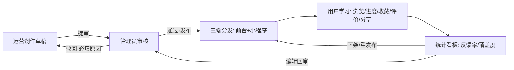
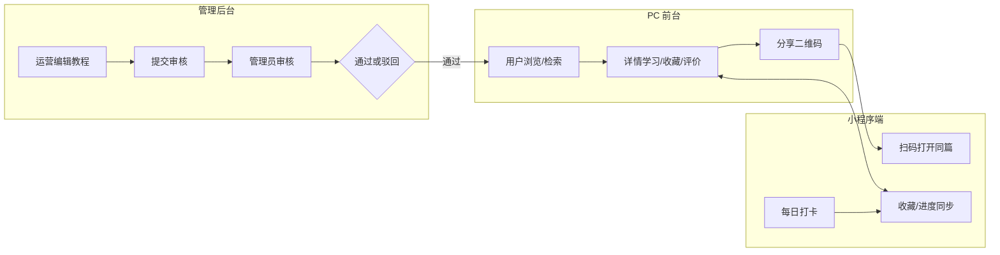
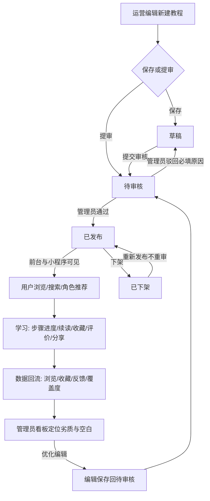
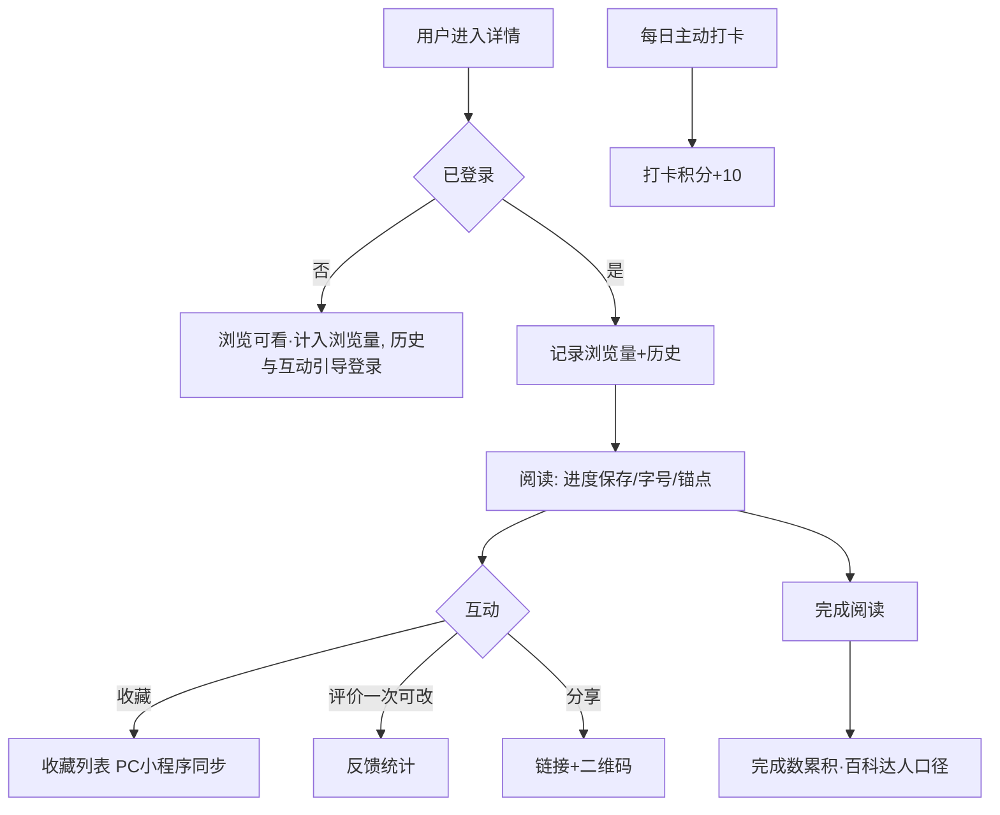
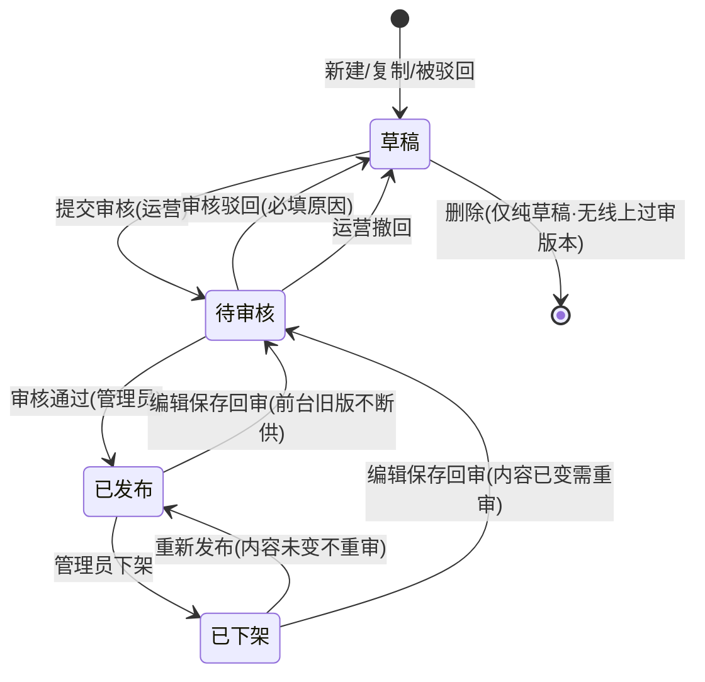
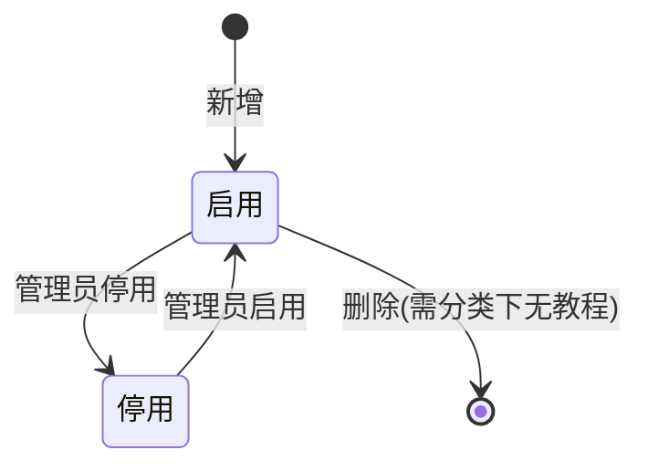
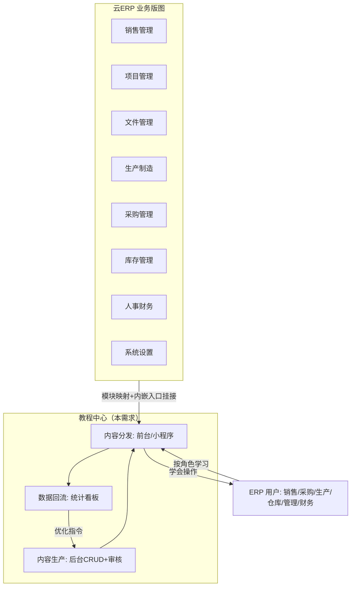
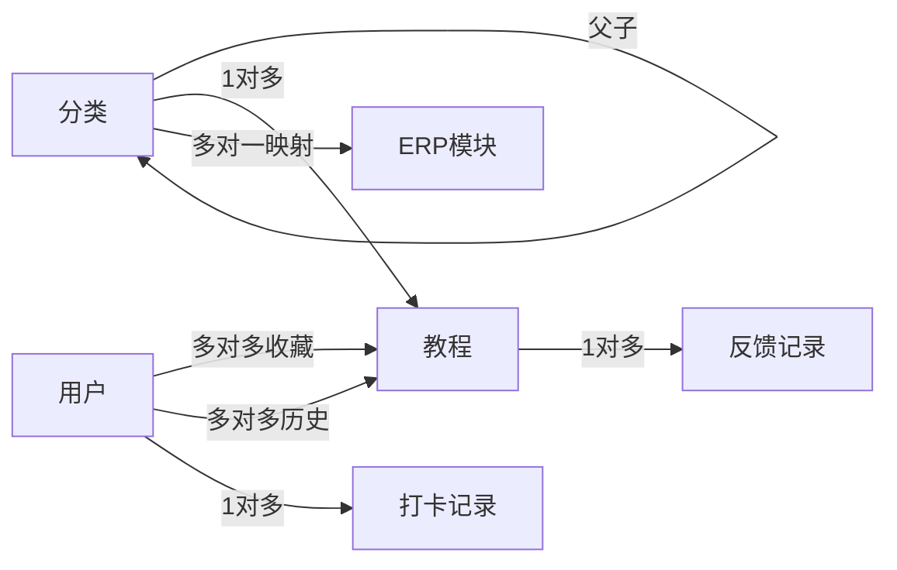

# 云ERP教程中心 PRD

> 状态：正式 | 版本：v1.0 | 作者：yuanbo | 需求：RE00001（云ERP教程中心·三端）

## 0. 文档元信息与术语定义

| 项 | 内容 |
|---|---|
| 文档状态 | 正式版 v1.0（草稿 v0.1 经人工整体评审通过与契约冻结后补全） |
| 需求编号 | RE00001 |
| PRD 类型 | saas-erp（SaaS ERP 子系统；多租户约束见 §10） |
| 场景类型 | A+B（新项目规划为主，云ERP挂接点按新增功能标注） |
| 业务域归属 | CMS 内容管理（主）；租户-用户角色体系（联动） |

**术语定义**（全文统一用词，派生自 `.cache/glossary.md`）：

| 术语 | 定义 |
|---|---|
| 教程 | 最小内容单元：图文+视频外链、步骤式操作引导，归属唯一分类 |
| 分类 / 分类树 | 多级教程分类体系，含排序与启停用，与 ERP 模块映射 |
| 模块映射 | 分类与云ERP 8 大模块（销售/项目/文件/生产制造/采购/库存/人事财务/系统设置）的关联关系 |
| 教程状态 | 草稿 / 待审核 / 已发布 / 已下架 四态生命周期 |
| 编辑回审 | 已发布教程再次编辑保存后自动回到待审核，前台旧版持续在线 |
| 审核驳回 | 待审核教程被退回草稿，必须附带驳回原因（作者可见） |
| 重新发布 | 已下架教程一键恢复已发布，内容未变不需重审 |
| 复制教程 | 以任意状态教程为源生成新草稿，计数清零 |
| 阅读进度 | 用户在某篇教程的阅读百分比，跨端云端同步续读 |
| 有帮助率 | 有帮助数 ÷（有帮助数 + 没帮助数），内容质量核心指标 |
| 覆盖度 | 按已启用分类统计已发布教程数量，数量为 0 即空白区 |
| 场景联动 | 按角色推荐、ERP 页内嵌入口、扫码直达、学习打卡四类联动能力 |
| 扫码直达 | PC 详情页二维码，扫码在小程序端打开同一教程 |
| 学习打卡 | 小程序端每日学习打卡、积分与连续天数徽章 |
| 上下篇 | 同分类内按排序的上一篇/下一篇跳转 |

**修订记录**：

| 日期 | 变更人 | 变更内容 |
|---|---|---|
| 2026-08-20 | yuanbo | v0.1 草稿：需求概述/功能清单/流程状态机 |
| 2026-08-20 | yuanbo | v1.0 正式：冻结核心闭环契约，补全 M05/M19/M08/M09/M10-M13/M15/M16/M03 |

## 1. 需求概述

### 1.1 需求背景

云ERP已覆盖 6 大核心能力与 8 大业务模块，订单全流程 7 个环节数字化运转，但用户学习仍依赖静态帮助文档：内容分散无法检索、无收藏与进度、无反馈通道、无移动端学习场景，运营也无法量化内容效果。新员工上手慢、"没帮助"的教程无法被识别优化，学习成本随产品迭代持续上升。为此立项建设产品化的教程中心子系统，覆盖 PC 前台、管理后台、小程序端三端。

### 1.2 需求价值与目标

让"找教程、学教程、管教程、优化教程"形成完整闭环：用户按岗位角色快速学会云ERP操作；运营通过审核流安全高效地生产内容；管理员通过数据看板定位劣质教程与内容空白区。可量化目标：8 大模块分类入口 100% 覆盖且每模块至少 1 篇已发布教程；关键词搜索 1s 内返回；教程四态流转（草稿→待审核→已发布→已下架）全线上；每篇教程的有帮助率可统计。

### 1.3 业务场景

| 业务场景 | 一句话描述 |
|---|---|
| 新员工上手学习 | 入职/转岗用户按角色推荐找到本岗位教程，步骤化跟学并断点续读 |
| 操作中被卡住随手查 | 用户在 ERP 功能页通过内嵌入口直达关联教程，锚点跳到目标小节 |
| 跨端碎片学习 | PC 学到一半，小程序继续（收藏/进度云端同步），扫码直达同篇 |
| 内容生产提审 | 运营编辑图文+视频教程，提审管理员把关，驳回带原因可重提 |
| 存量内容优化 | 管理员按"没帮助"优先清单定位劣质教程，编辑回审后替换线上版本 |
| 内容体系治理 | 管理员维护分类树与模块映射，按覆盖度统计规划内容补空白 |
| 学习激励 | 小程序端每日学习打卡攒积分得徽章，养成学习习惯 |

## 1A. 核心闭环契约（评审基线）

**一段话契约**：运营编辑在后台创建教程（草稿）并提交审核，平台管理员在审核队列审核——通过则教程变为已发布并即时出现在 PC 前台与小程序端；驳回则必填原因、教程回草稿待运营修改重提。用户在前台/小程序按分类、关键词或角色推荐找到教程，学习过程中产生浏览、进度、收藏、评价、分享数据；这些数据回流后台统计看板，驱动管理员下架劣质内容（下架后重新发布不重审）、安排运营优化（已发布教程编辑保存自动回待审核，前台旧版不断供）与补齐覆盖空白，形成"生产→分发→消费→反馈→优化"完整闭环。

| 要素 | 契约声明 |
|---|---|
| 触发 | 运营编辑点击"提交审核"，教程由草稿进入待审核，进入管理员审核队列 |
| 主路径 | 草稿 → 提审 → 审核通过 → 已发布 → 前台/小程序可见 → 用户浏览学习互动 → 统计回流 → 看板复盘 |
| 结果 | 教程安全上线被用户学会（有帮助率可衡量），内容质量与覆盖度持续提升 |
| 关键异常出口 | 审核驳回（必填原因回草稿，可改后重提）；已发布可下架（收藏夹标注"已下架"）；下架可重新发布（内容未变不重审） |
| 核心实体状态流转 | 教程：草稿→待审核→已发布→已下架；已发布编辑保存→待审核（回审）；驳回→草稿 |
| 功能间映射 | 教程发布→前台列表/搜索/角色推荐/小程序即时可见；浏览/评价数据→统计看板与没帮助优先清单；分类模块映射→角色推荐与 ERP 内嵌入口命中集 |

## 2. 功能清单

| 模块 | 界面 | 按钮 | 核心功能点 | 状态(新增/修改/复用) | 优先级 |
|---|---|---|---|---|---|
| 前台·入口与首页 | 教程首页 | — | 顶部导航"教程中心"入口（全局可达） | 新增 | P0 |
| 前台·入口与首页 | 教程首页 | — | 推荐教程、最近更新、热门教程内容区块 | 新增 | P0 |
| 前台·入口与首页 | 教程首页 | 分类入口 | 8 大模块分类宫格导航 | 新增 | P0 |
| 前台·浏览检索 | 教程列表页 | 筛选/搜索 | 分类筛选、标签筛选、关键词搜索（标题/摘要/标签） | 新增 | P0 |
| 前台·浏览检索 | 教程详情页 | — | 图文/视频内容展示，步骤式操作引导 | 新增 | P0 |
| 前台·浏览检索 | 教程详情页 | 上一篇/下一篇 | 同分类上下篇快速跳转 | 新增 | P1 |
| 前台·浏览检索 | 教程详情页 | 目录锚点 | 正文目录侧边导航锚点跳转 | 新增 | P1 |
| 前台·浏览检索 | 教程详情页 | 字号调节 | 正文字号档位调节 | 新增 | P2 |
| 前台·用户互动 | 教程详情页 | 收藏 | 收藏/取消收藏教程 | 新增 | P0 |
| 前台·用户互动 | 教程详情页 | 有帮助/没帮助 | 教程评价（每篇每人一次可修改） | 新增 | P0 |
| 前台·用户互动 | 教程详情页 | 留言 | 反馈留言补充说明（仅后台可见） | 新增 | P1 |
| 前台·用户互动 | 教程详情页 | 分享 | 生成教程链接与二维码（分享同事） | 新增 | P1 |
| 前台·用户互动 | 我的 | — | 收藏列表、浏览历史（含阅读进度与已下架标注） | 新增 | P0 |
| 前台·场景联动 | 教程首页/详情页 | — | 按登录用户 ERP 角色推荐教程 | 新增 | P1 |
| 前台·场景联动 | 模拟 ERP 工作台页 | 查看教程 | ERP 功能页右下角内嵌教程入口（模块映射联动） | 新增 | P1 |
| 后台·内容管理 | 教程列表 | 新建/编辑/删除/复制/撤回 | 教程 CRUD 与复制（计数清零重置草稿）；待审核可撤回修改 | 新增 | P0 |
| 后台·内容管理 | 教程编辑器 | 保存草稿/提交审核 | 轻量富文本编辑（标题/加粗/列表/图片/视频外链） | 新增 | P0 |
| 后台·内容管理 | 教程列表 | 提审/下架/重新发布 | 状态流转：草稿→待审核→已发布→已下架（下架后可重新发布；"变为已发布"由审核队列"通过"完成，列表不设直达发布按钮） | 新增 | P0 |
| 后台·内容管理 | 教程编辑器 | 预览 | 发布前预览前台渲染效果 | 新增 | P2 |
| 后台·目录管理 | 分类树管理 | 新增/编辑/删除 | 多级分类管理（删除保护：分类下有教程时阻断） | 新增 | P0 |
| 后台·目录管理 | 分类树管理 | 排序/启停用 | 分类拖拽排序、启用停用 | 新增 | P1 |
| 后台·目录管理 | 教程排序 | 置顶/排序 | 教程置顶与分类内排序调整 | 新增 | P1 |
| 后台·目录管理 | 模块映射维护 | 保存映射 | 分类与 ERP 系统模块映射关系维护 | 新增 | P1 |
| 后台·审核流程 | 审核队列 | 通过/驳回 | 待审核教程处理，驳回必填原因 | 新增 | P0 |
| 后台·审核流程 | AI 生成审核 Tab | — | 预留 AI 自动生成教程审核通道（本期 mock） | 新增 | P2 |
| 后台·数据统计 | 统计看板 | — | 浏览量/收藏量/有帮助率总览与趋势 | 新增 | P1 |
| 后台·数据统计 | 反馈分析 | — | 没帮助优先清单（没帮助占比>50% 标红）与留言明细 | 新增 | P1 |
| 后台·数据统计 | 覆盖度统计 | — | 按模块统计教程覆盖情况与空白区 | 新增 | P1 |
| 小程序·浏览学习 | 首页 | 搜索/分类宫格 | 分类浏览、关键词搜索（移动端列表交互） | 新增 | P0 |
| 小程序·浏览学习 | 详情页 | 字号调节/有帮助评价 | 移动端图文/视频展示、字号可调、评价（规则同前台） | 新增 | P0 |
| 小程序·浏览学习 | 收藏与历史 | — | 收藏、浏览历史（与 PC 端数据打通） | 新增 | P0 |
| 小程序·场景联动 | 首页 | — | 按角色推荐教程 | 新增 | P1 |
| 小程序·场景联动 | 详情页（被扫码打开） | — | 扫码直达：PC 二维码打开同篇教程 | 新增 | P1 |
| 小程序·学习激励 | 打卡页 | 打卡/徽章墙 | 每日学习打卡、积分、连续徽章 | 新增 | P2 |
| 公共·账号 | 登录 | 登录 | 选角色登录（普通用户）/ 账号密码登录（后台两级角色） | 新增 | P0 |

> 只列清单，字段细节与业务规则属正式版功能详细说明（M09）。

## 3. 业务流程与状态机

### 3.1 业务实体

**角色/系统**：

| 角色/系统 | 职责 |
|---|---|
| ERP 普通用户（销售/采购/生产/仓库/管理/财务） | 浏览、检索、学习、收藏、评价、打卡 |
| 运营编辑（operator） | 教程创作、编辑、提审、复制 |
| 平台管理员（admin） | 审核（通过/驳回）、发布、下架、分类治理、看板复盘 |
| 云ERP系统（既有） | 提供模块体系与用户角色体系；导航入口与内嵌引导的挂接宿主 |

**核心数据实体**：

| 实体 | 核心字段 | 来源 |
|---|---|---|
| 分类 | 名称、父分类、排序、启用状态、ERP模块映射 | 管理员维护 |
| 教程 | 标题、分类、摘要、图文正文、视频外链、标签、状态、置顶、排序、浏览量、收藏量、有帮助数、驳回原因、作者 | 运营编辑创建 |
| 收藏关系 | 用户、教程、收藏时间 | 用户操作 |
| 浏览历史 | 用户、教程、阅读进度、最近阅读时间 | 用户阅读行为 |
| 反馈记录 | 教程、是否有帮助、留言、用户、时间 | 用户评价 |
| 打卡记录 | 用户、日期、积分、连续天数、徽章 | 小程序打卡 |
| 用户 | 用户名、角色类型、ERP 角色 | 预置账号体系 |

### 3.2 泳道图（多端交互）

### 3.3 主流程图

### 3.4 子流程图（用户学习互动）

### 3.5 状态机（教程）

> 前台可见性=存在线上过审版本且当前状态非"已下架"（回审等待/驳回/撤回期间旧版持续在线，见 §6 前台可见性规则）。

状态机（分类）：

## 4. 范围定义

**In Scope（本次做）**：交付 §2 功能清单全部 35 条（三端 + 公共账号，P0/P1/P2 全量，其中字号调节为 P2 项、详情页基础排版属 P0 基础能力）；四类场景联动（按角色推荐、扫码直达、ERP 内嵌入口、学习打卡）；种子内容（12 分类 + 16~20 篇取材云ERP真实业务知识的教程）。

**Out of Scope（本次明确不做）**：

| # | 不做项 | 原因 |
|---|---|---|
| 1 | 真实云ERP系统代码改动 | 本期为独立子系统 demo，导航入口用模拟工作台页演示 |
| 2 | 公司通用登录（passport）对接 | demo 使用本地账号体系 |
| 3 | 多租户数据隔离的落地实现 | demo 单租户，§10 说明设计思路与升级路径 |
| 4 | 教程评论公开展示 | 留言仅进后台反馈分析，规避 UGC 审核依赖 |
| 5 | 视频上传托管 | 采用外链 URL 嵌入（mp4 直链） |
| 6 | 新手引导弹窗、消息推送关联 | 迭代池（proposal 已分流，用户已确认） |
| 7 | 教程付费、作者激励、原生小程序壳 | 非本期目标 |

## 5. 业务全景定位（M19）

| 涉及业务域 | 关系 | 交互方式 |
|---|---|---|
| CMS 内容管理（教程中心本体） | 生产→分发→回流闭环 | 后台发布内容即时驱动三端可见性 |
| 租户-用户角色体系 | 消费角色映射 | 复用云ERP角色枚举（销售/采购/生产/仓库/管理/财务）驱动角色推荐 |
| 云ERP 8 大模块 | 内容组织骨架 | 分类树与模块一对一/多对一映射，支撑场景联动 |

## 6. 数据模型（M08）

> 业务语言描述；表结构设计见技术方案文档。

**实体关系**：

**教程（核心实体）字段定义**：

| 字段 | 类型/约束 | 说明 |
|---|---|---|
| 标题 | 必填，唯一性不强制，≤100 字 | 列表与搜索主展示 |
| 所属分类 | 必填，引用分类树启用节点 | 唯一归属 |
| 摘要 | 必填，≤200 字 | 列表卡片展示、搜索命中字段 |
| 图文正文 | 必填，富文本 HTML | 步骤式内容（标题/加粗/列表/图片/视频外链） |
| 视频外链 | 可选，mp4 直链 | 详情页视频区渲染，失效给占位提示 |
| 标签 | 可选，多值，≤5 个 | 列表筛选与搜索命中字段 |
| 状态 | 草稿/待审核/已发布/已下架 | 见 §3.5 状态机 |
| 驳回原因 | 驳回时必填 ≥5 字 | 作者可见，驱动修改重提 |
| 置顶/排序 | 布尔 + 整数 | 置顶优先，其余按排序值与发布时间 |
| 浏览量/收藏量/有帮助数/没帮助数/分享数 | 整数，默认 0 | 统计看板数据源；分享数本期仅数据留存（写入方为前台/小程序分享动作）；复制教程时清零 |
| 线上过审版本 | 最近一次审核通过的内容快照 | 前台/小程序展示依据；回审等待与驳回期间持续在线（不断供） |
| 作者/审核人/审核时间 | 引用用户 | 审核留痕（隐性需求 5） |
| 创建/更新时间 | 时间戳 | "最近更新"区块依据 |

**状态枚举（教程）**：

| 状态 | 含义 | 触发条件 | 可流转到 |
|---|---|---|---|
| 草稿 | 创作中，仅作者后台可见 | 新建/复制/被驳回（含回审版被驳回）/待审核撤回 | 待审核（提审）/ 删除（仅纯草稿，无线上过审版本） |
| 待审核 | 等待管理员处理 | 提交审核 / 已发布（已下架）教程编辑保存回审 | 已发布（通过）/ 草稿（驳回或撤回） |
| 已发布 | 三端可见 | 审核通过 / 下架后重新发布 | 已下架（下架）/ 待审核（编辑保存回审） |
| 已下架 | 前台不可见，收藏夹标注 | 管理员下架 | 已发布（重新发布，内容未变不重审）/ 待审核（编辑保存回审） |

**前台可见性规则（与契约"旧版不断供"对齐）**：前台/小程序展示依据为教程的**线上过审版本**（最近一次审核通过的内容快照，见教程字段表）。可见 = 存在线上过审版本，且该教程"未被下架"。具体判定：① 已发布态 → 展示线上过审版本；② 已发布教程编辑回审等待期间、回审版被驳回/撤回期间 → **继续展示线上过审版本**（仅编辑版回草稿，旧版不断供）；③ 已下架 → 不展示（收藏夹标注"已下架"）；④ **已下架教程进入编辑回审（及其回审版被驳回/撤回落草稿）期间，维持"不可见"语义**——仅当回审通过（回到已发布态）后恢复可见（回审版被驳回/撤回的，需运营重新提审并再次通过），防止"下架被编辑动作意外解除"；⑤ 从未通过审核的教程（纯草稿、首次待审核）→ 任何场景不可见。列表、搜索、首页区块（推荐/最近更新/热门）、角色推荐与小程序均按本规则统一取数（契约所述"三端可见"默认基于启用分类；停用分类可达性见 §13 开放问题 3）。

**其他实体核心字段**：

| 实体 | 核心字段 | 业务约束 |
|---|---|---|
| 分类 | 名称/父分类/排序/状态/ERP模块映射 | 删除保护：分类下存在教程时阻断；停用分类不进前台入口 |
| 用户 | 用户名/角色类型（admin/运营/普通用户）/ERP 角色 | 后台两级角色；前台按 ERP 角色推荐 |
| 收藏关系 | 用户/教程/时间 | 同一用户同一教程唯一；PC/小程序同库 |
| 浏览历史 | 用户/教程/阅读进度/最近阅读时间 | 同一用户同一教程一条，进度覆盖更新 |
| 反馈记录 | 教程/是否有帮助/留言/用户/时间 | 每篇每人一条可修改；留言仅后台可见 |
| 打卡记录 | 用户/日期/积分/连续天数 | 每日一次 +10 积分；连续 7 天发徽章，中断清零连续数不清积分 |

## 7. 功能详细说明（M09）

> 业务域标注：〔CMS〕内容管理域功能；〔租户〕用户角色体系相关。租户隔离：demo 单租户实现，§10 说明升级路径。

### 7.1 前台·教程首页 〔CMS〕

| 区块 | 业务规则 |
|---|---|
| 导航入口 | 顶部导航"教程中心"，全局可达；未登录可浏览 |
| 推荐教程 | 取数口径=§6 前台可见性规则（启用分类 + 存在线上过审版本 + 未下架，回审期间按旧版数据参与排序）。已登录：按用户 ERP 角色匹配分类模块映射，取该映射下已发布教程浏览量 Top6；未登录：全站已发布教程浏览量 Top6；命中集不足 6 条时展示实际数量。最近更新/热门教程区块池与推荐位同口径。角色-模块映射：销售→销售管理；采购→采购管理、库存管理；生产→生产制造、项目管理；仓库→库存管理；财务→人事财务、销售管理；管理→全部 8 模块 |
| 最近更新 | 前台可见教程（§6 口径）按更新时间倒序 Top6 |
| 热门教程 | 前台可见教程（§6 口径）按浏览量倒序 Top6 |
| 分类宫格 | 已启用一级分类 12 个（8 模块 + 新手入门/最佳实践/常见问题/开放平台），角标显示该分类已发布教程数，0 篇显示"待补充" |

### 7.2 前台·教程列表页 〔CMS〕

| 功能 | 业务规则 |
|---|---|
| 分类筛选 | 左侧分类树（仅启用分类），选中后右侧列表联动；上下篇顺序=该分类内排序 |
| 标签筛选 | 从已发布教程聚合的标签集合，多选（交集） |
| 关键词搜索 | 检索范围=存在线上过审版本且未被下架的教程（**含回审等待/驳回/撤回期间的旧版**，与 §6 前台可见性规则同口径）；从未过审内容（纯草稿、首次待审核）、已下架教程、停用分类下的内容不命中；命中标题/摘要/标签三字段即返回，1s 内响应；空结果展示引导（清空筛选/去分类浏览）。列表页分类筛选的列表池与搜索同口径 |
| 列表卡片 | 标题/摘要/标签/浏览量/收藏量/更新时间；置顶教程带"置顶"角标排最前 |
| 互动前置 | 未登录点击收藏/评价 → 弹出选角色登录，登录后回到原页面原位置继续操作 |

### 7.3 前台·教程详情页 〔CMS〕〔租户〕

| 功能 | 业务规则 |
|---|---|
| 内容展示 | 图文正文 + 视频外链播放（失效显示占位提示）；步骤式内容渲染步骤序号与进度条 |
| 步骤进度条 | 正文按步骤标题拆分，勾选完成步骤 → 进度百分比更新并保存 |
| 目录锚点 | 侧边导航列出正文各级标题，点击平滑滚动定位 |
| 字号调节 | 三档（标准/大/特大），仅影响正文，本地记忆 |
| 阅读进度 | 按滚动位置自动保存百分比；再次进入弹"继续阅读"提示，跨端同步 |
| 上下篇 | 同分类内按排序取上一篇/下一篇，无则按钮置灰 |
| 收藏 | 登录后可收藏/取消；收藏数实时更新；两端同步 |
| 评价 | 有帮助/没帮助 二选一，每篇每人一次，可修改；选中态高亮 |
| 留言 | 评价"没帮助"时展开留言框（选填 ≤200 字），提交仅进后台 |
| 分享 | 复制链接按钮 + 二维码弹窗（二维码内容=该教程小程序端 URL） |
| 关联推荐 | 详情底部按同分类前台可见教程（§6 口径，排除本篇）取 4 篇 |
| 已下架处理 | 收藏夹/历史进入已下架教程 → 页面提示"该教程已下架"并给同类推荐，正文不可见 |

### 7.4 前台·我的（收藏与历史）〔CMS〕〔租户〕

| 功能 | 业务规则 |
|---|---|
| 收藏列表 | 按收藏时间倒序；已下架教程灰显并标注"已下架"，不可进入正文 |
| 浏览历史 | 按最近阅读时间倒序，显示阅读进度百分比；点击从进度处续读 |

### 7.5 前台·模拟 ERP 工作台页（内嵌引导演示）〔CMS〕

| 功能 | 业务规则 |
|---|---|
| 模拟页面 | 还原云ERP工作台框架（侧边模块菜单：销售/采购/生产/库存等占位卡片） |
| 查看教程入口 | 每个模块卡片右下角"查看教程"按钮 → 跳转列表页并选中该模块映射分类 |
| 新手引导（迭代池预留位） | 首次进入弹窗位本期不启用，仅保留交互占位 |

### 7.6 后台·教程管理 〔CMS〕

| 功能 | 业务规则 |
|---|---|
| 列表 | 全状态展示（草稿/待审核/已发布/已下架 + 驳回原因列），按状态/分类/关键词筛选 |
| 新建/编辑 | 必填校验：标题/所属分类/摘要/正文；富文本工具：标题/加粗/列表/图片 URL/视频外链；保存草稿可反复 |
| 提交审核 | 草稿→待审核；待审核状态可撤回（回草稿）修改 |
| 编辑回审 | 已发布/已下架教程保存编辑 → 自动回待审核（不提供"保存为草稿"语义，任何保存即回审）；前台持续展示线上过审版本；过审后新版替换；**回审版被驳回或撤回时仅编辑版回草稿，前台继续展示线上过审版本不断供** |
| 下架/重新发布 | 管理员对已发布教程下架（二次确认、留痕，三端即时不可见，收藏夹标注）；对已下架教程一键重新发布（内容未变不重审，前台即时恢复，浏览/收藏计数延续） |
| 复制 | 源教程任意状态 → 生成新草稿（标题加"（副本）"），浏览/收藏/反馈/分享计数清零 |
| 删除 | 仅"从未通过审核的纯草稿"可删，二次确认；存在线上过审版本的教程（含已发布、已下架、以及因回审驳回/撤回落草稿但旧版仍在线的情况）一律不提供删除，以下架归档代替（防误删线上内容，删除保护判定以"是否存在线上过审版本"为准） |
| 预览 | 编辑器内预览前台渲染效果 |
| 置顶/排序 | 置顶布尔 + 排序值编辑，影响前台列表与上下篇 |

### 7.7 后台·审核队列 〔CMS〕

| 功能 | 业务规则 |
|---|---|
| 队列列表 | 待审核教程按提交时间倒序；展示分类/作者/提交时间/是否修改版（v2+）标识；支持分类筛选 |
| 通过 | 待审核→已发布，记录审核人与审核时间，前台即时可见 |
| 驳回 | 必填原因 ≥5 字（前端阻断 + 后端校验）；待审核→草稿，原因展示在编辑页顶部；**若被驳回对象为曾发布教程的回审版，仅编辑版回草稿，前台继续展示该教程线上过审版本（回审来源为已发布态时；来源为已下架态按 §6 规则④维持不可见）** |
| 互斥约束 | 运营撤回与管理员审核动作互斥，后到动作失效并提示 |
| AI 生成审核 Tab | 独立 Tab 展示 mock 的 AI 生成教程队列（标识"AI 生成"），本期仅展示不可操作 |

### 7.8 后台·目录管理 〔CMS〕

| 功能 | 业务规则 |
|---|---|
| 分类树 | 多级（本期限两级）展示，新增/编辑名称与父分类 |
| 删除保护 | 分类下存在任意状态教程 → 阻断删除，提示"请先移走 N 篇教程" |
| 排序 | 同级分类拖拽或排序值调整，影响前台宫格与列表顺序 |
| 启停用 | 停用分类前台隐藏（宫格/筛选），其下已发布教程仍可经收藏/历史/直达链接访问 |
| 模块映射维护 | 分类绑定 ERP 模块（8 选 1 或不限），驱动角色推荐与内嵌入口命中集 |

### 7.9 后台·统计看板 〔CMS〕

| 功能 | 业务规则 |
|---|---|
| 总览 | 已发布教程数/总浏览量/总收藏量/平均有帮助率 4 指标卡 + 浏览量 Top10 条形图（口径说明见指标定义） |
| 反馈分析 | 按"没帮助占比"倒序列出教程（占比 >50% 标红），支持展开查看留言明细 |
| 覆盖度统计 | 已启用分类 × 已发布教程数矩阵；0 篇分类标"空白区"；按模块映射聚合出模块级覆盖数 |
| 指标定义 | 浏览量=打开详情次数（含未登录打开，去重仅按账号维度不做——游客打开计入，与 §3.4 一致：游客浏览不计历史/进度，但计入浏览量）；收藏量=当前有效收藏数；有帮助率=有帮助÷(有帮助+没帮助)，零反馈教程显示"—"且不计入平均有帮助率与标红判定；没帮助占比=没帮助÷(有帮助+没帮助)，>50% 标红；总览指标仅统计当前前台可见口径的教程（已下架教程历史计数不计入，与列表可对账）；覆盖度"已发布教程数"按前台可见口径统计（回审期间旧版在线计入）；分享行为本期仅数据留存（教程增加分享计数字段），不上看板卡片；完成率=进度 100% 历史数÷历史数，v1.1 上看板（见 §13 开放问题 4） |

### 7.10 小程序端（H5） 〔CMS〕〔租户〕

| 功能 | 业务规则 |
|---|---|
| 首页 | 角色推荐位（同 7.1 规则的移动版）+ 分类宫格 + 打卡入口 |
| 列表与搜索 | 分类浏览 + 关键词搜索（命中规则同 7.2），下拉刷新 |
| 详情 | 移动端图文/视频展示；字号三档调节；进度续读与 PC 同步；有帮助/没帮助评价（规则同 7.3，与 PC 共用同一评价记录） |
| 收藏与历史 | 与 PC 端同一数据，任一端操作另一端刷新可见 |
| 扫码直达 | PC 二维码 URL 打开即为此页；已下架给提示页 |
| 学习打卡 | 每日一次 +10 积分；徽章：坚持者（连续 7 天打卡）、百科达人（累计完成 20 篇教程）；中断只清连续天数不清积分 |

### 7.11 公共·账号 〔租户〕

| 功能 | 业务规则 |
|---|---|
| 前台/小程序登录 | 选角色快速登录（销售/采购/生产/仓库/管理/财务 6 个演示账号），登录态本地保持 |
| 后台登录 | 账号密码（admin/运营编辑两类角色），错误提示统一"账号或密码错误" |
| 权限边界 | 运营：建/编/提审/复制/撤回；管理员：审核/发布/下架/分类管理/看板（见 §10 矩阵） |

## 8. 关联与影响（M10）

| 关联系统/模块 | 改动类型 | 联动方式 | 业务域 |
|---|---|---|---|
| 云ERP顶部导航 | 新增（demo 模拟） | 增加"教程中心"入口，点击进入前台首页 | CMS↔ERP 前端壳 |
| 云ERP功能页（工作台） | 新增（demo 模拟） | 模块卡片右下角"查看教程"，按模块映射跳转列表 | CMS↔ERP 前端壳 |
| 云ERP角色体系 | 复用 | 教程中心登录用户携带 ERP 角色，驱动角色推荐 | CMS↔租户 |
| 小程序端容器 | 新增（H5 形态） | 与 PC 共用同一账号与数据层，收藏/历史/进度互通 | CMS 三端分发 |
| 帮助中心静态文档（存量） | 不改动 | 教程中心为新体系，存量文档后续迁移进迭代池 | — |

**跨域联动关键点**：教程状态变为已发布 → 前台/小程序/搜索/推荐四处可见性同步变化；分类停用 → 角色推荐命中集与内嵌入口命中集即时收窄；反馈数据写入 → 反馈分析看板即时可查。

## 9. 异常与边界（M11）

### 数据异常

| 异常 | 触发条件 | 系统行为 | 提示文案 | 恢复方式 |
|---|---|---|---|---|
| 教程标题/分类/摘要/正文缺失 | 提审时校验失败 | 阻断提审，高亮缺失项 | "请补全标题/分类/摘要/正文后再提交" | 补全后重新提审 |
| 视频外链失效 | 详情页加载视频失败 | 显示占位图与提示，正文可读 | "视频暂不可用，可先阅读图文步骤" | 运营后台更新外链（走回审） |
| 分类下仍有教程时删除 | 管理员点删除 | 阻断删除 | "该分类下还有 N 篇教程，请先移走" | 移动教程后重试删除 |

### 操作异常

| 异常 | 触发条件 | 系统行为 | 提示文案 | 恢复方式 |
|---|---|---|---|---|
| 驳回未填原因 | 原因 <5 字提交 | 阻断提交 | "请填写至少 5 个字的驳回原因" | 补充原因后提交 |
| 重复提审 | 运营对同一教程连点提审 | 按钮防抖，仅首次生效 | 无（静默防抖） | — |
| 审核与撤回并发 | 管理员审核同时运营撤回 | 后到动作失效 | "该教程状态已变化，请刷新" | 刷新后按新状态操作 |
| 编辑保存冲突 | 两名运营同时编辑同一篇 | 后保存者收到覆盖告知 | "他人已保存新版本，请刷新后合并" | 刷新对比后重存 |
| 编辑器内容丢失风险 | 浏览器崩溃/误关标签页 | 编辑器每 30 秒自动保存草稿；再次进入提示恢复最近草稿 | "已恢复未保存的编辑内容" | 恢复或放弃恢复 |
| 阅读进度保存失败 | 保存进度请求失败 | 静默重试一次；仍失败则保留本地最近值 | 无（不打断阅读） | 下次进入回退最近保存值 |

### 权限异常

| 异常 | 触发条件 | 系统行为 | 提示文案 | 恢复方式 |
|---|---|---|---|---|
| 运营尝试审核/发布 | 非管理员调用管理接口 | 拒绝（403） | "无权限执行该操作" | 联系管理员处理 |
| 未登录用户收藏/评价 | 游客点击互动 | 弹出选角色登录 | "登录后即可收藏/评价" | 登录后回原位继续 |
| 后台未登录访问 | 直接输入后台 URL | 跳转后台登录页 | — | 登录后进入 |

### 环境异常

| 异常 | 触发条件 | 系统行为 | 提示文案 | 恢复方式 |
|---|---|---|---|---|
| 弱网加载图文 | 车间/仓库网络差 | 文字先行渲染，图片懒加载 | 图片加载中占位 | 网络恢复自动补载 |
| 搜索响应超时 | 数据异常或服务波动 | 前端 1s 超时兜底 | "搜索超时，请重试" | 重试或走分类浏览 |
| 空数据全新库 | 刚初始化无种子 | 看板/列表显示空态引导 | "暂无数据" + 引导入口 | 导入种子或新建内容 |

### 防错机制汇总

驳回原因必填双重校验（前端+后端）；删除仅限从未通过审核的纯草稿（存在线上过审版本一律不可删，见 §7.6）；分类删除保护；提审/审核按钮防抖；状态机非法迁移后端拒绝（如草稿直接发布）。

## 10. 权限与敏感信息（M12）

### 功能权限矩阵

| 功能 | 平台管理员 | 运营编辑 | 普通用户（前台/小程序） | 游客 |
|---|---|---|---|---|
| 浏览/搜索/详情 | ✅ | ✅ | ✅ | ✅ |
| 收藏/历史/评价/打卡 | ✅ | ✅ | ✅ | ❌（引导登录） |
| 教程新建/编辑/复制/撤回 | ✅ | ✅ | ❌ | ❌ |
| 提交审核 | ✅ | ✅ | ❌ | ❌ |
| 审核通过/驳回 | ✅ | ❌ | ❌ | ❌ |
| 发布/下架/重新发布 | ✅ | ❌ | ❌ | ❌ |
| 删除教程（草稿） | ✅ | ✅（仅本人名下） | ❌ | ❌ |
| 分类树管理/映射维护 | ✅ | ❌ | ❌ | ❌ |
| 统计看板 | ✅ | ✅（只读） | ❌ | ❌ |

### 租户隔离说明（saas-erp 类型必含）

| 维度 | demo 实现 | 生产升级路径 |
|---|---|---|
| 数据隔离 | 单租户共享库（教程内容本身为平台级公共数据，非租户私有） | 用户行为数据（收藏/历史/反馈/打卡）按租户标识列隔离；内容表保持平台级 |
| 权限隔离 | 平台管理员 vs 运营编辑 vs 普通用户三级 | 增加租户管理员角色（仅本企业成员可见性配置），平台管理员与租户管理员权限分离 |
| 配置隔离 | 无租户级配置 | 分类树若需租户定制，引入租户级配置覆盖层 |

### 敏感信息处理

**不涉及**。本期无手机号/邮箱/身份证号/银行卡号/客户姓名字段。留言内容为教程反馈，仅后台可见，入库前做长度限制（≤200 字）。

## 11. 非功能需求（M13）

| 类别 | 指标 |
|---|---|
| 性能 | 关键词搜索 P95 < 1s（百级教程量）；详情页首屏 < 2s（弱网文字先行） |
| 兼容 | PC：Chrome/Edge 最近两个大版本；小程序 H5：375px 视口适配主流机型 |
| 安全 | 后台接口鉴权全覆盖；富文本正文渲染前做脚本剥离（防注入）；管理操作留痕 |
| 可用性 | 图文教程弱网可读；视频仅提示流量不自动播放 |
| 数据 | 种子数据可重复初始化（重置脚本）；数据库单文件便于交付 |

## 12. 版本规划（M15）

| 版本 | 范围 | 里程碑 |
|---|---|---|
| v1.0（本期） | §2 功能清单全部 P0/P1/P2 + 四类场景联动 + 种子内容；Playwright 验收全通过 | 独立可运行交付（本作业） |
| v1.1（迭代池） | 新手引导弹窗、消息推送关联教程 | 联动能力补全 |
| v1.2（迭代池） | 视频上传托管、存量帮助文档迁移 | 内容基建 |
| v2.0（远期） | 多租户落地、AI 自动生成教程审核通道启用、步骤级完成率漏斗 | 平台化 |

## 13. 开放问题与风险（M16）

**开放问题**（demo 期由作者决策关闭，生产期需复核）：

| # | 问题 | 当前决策 | 责任人 | 复核时间 |
|---|---|---|---|---|
| 1 | 教程正文富文本能力边界 | 标题/加粗/列表/图片/视频五类，满足步骤式教程 | yuanbo | 生产立项时 |
| 2 | 浏览量统计口径（去重与否） | 打开即计（粗粒度热度指标），口径在看板明示 | yuanbo | v1.2 |
| 3 | 停用分类下教程可达性 | 收藏/历史/直达可达，前台导航隐藏且搜索不命中 | yuanbo | v1.1 |
| 4 | 完成率指标上看板 | 本期仅口径定义与数据留存，v1.1 加入总览指标卡 | yuanbo | v1.1 |

**风险**：

| 风险 | 可能性 | 影响 | 缓解措施 |
|---|---|---|---|
| 轻量富文本编辑器复杂排版丢失 | 低 | 中 | 教程限定步骤式图文模板，编辑器能力边界写入运营规范 |
| 三端数据同步不一致 | 中 | 低 | 收藏/进度单值后写覆盖，以最新为准；Playwright 用例覆盖跨端同步 |
| 种子教程业务深度不足 | 中 | 中 | 全部取材官方帮助中心 PDF 真实业务知识 |
| 单人交付范围过大 | 中 | 高 | zcode 流水线分工（PRD→UI→任务拆分→前后端→测试），每阶段有门禁产物 |

## 14. 验收标准（M03）

### 14.1 验收策略概览（M03a）

验收方法论：以 §1A 核心闭环契约为基线，三端用户旅程走查 + API 契约测试 + Playwright 端到端自动化（含截图）。总体验收维度：功能完整性（35 条功能清单逐条可演示）、状态机正确性（四态流转与非法迁移拒绝）、三端一致性（收藏/进度同步）、数据可统计（看板指标口径可解释）、异常处理（§9 四维度触发即验）。

### 14.2 详细验收标准（M03b · Given-When-Then）

| 编号 | Given | When | Then | 来源 |
|---|---|---|---|---|
| AC-FN-01 | 种子库就绪，12 个分类已启用 | 打开前台首页 | 8 大模块分类宫格全部可达，每模块分类下已发布教程 ≥1 篇 | §7.1 |
| AC-FN-02 | 前台列表页 | 输入关键词"算料"搜索 | 1s 内返回命中标题/摘要/标签的教程列表；无结果显示空态引导 | §7.2 |
| AC-FN-03 | 用户未登录 | 点击收藏 | 弹出选角色登录，登录后回到原页面且收藏成功 | §7.2 |
| AC-FN-04 | 用户已登录，打开详情页 | 阅读并滚动到 60% 后离开，再次进入 | 显示"继续阅读"且进度 60%；小程序端同账号进度一致 | §7.3 |
| AC-FN-05 | 详情页 | 点击有帮助→改点没帮助 | 评价切换成功，有帮助-1 没帮助+1，每篇仅一条记录 | §7.3 |
| AC-FN-06 | 详情页 | 点击分享 | 展示链接复制与二维码；二维码内容为小程序端同篇 URL | §7.3 |
| AC-FN-07 | 运营登录后台 | 新建教程（必填齐）并提审 | 教程进入待审核队列，前台不可见 | §7.6/7.7 |
| AC-FN-08 | 管理员在审核队列 | 通过该教程 | 状态变已发布，前台列表即时可见 | §7.7 |
| AC-FN-09 | 管理员在审核队列 | 驳回且原因 <5 字 | 阻断并提示"请填写至少 5 个字的驳回原因"；填写后驳回成功，教程回草稿且编辑页顶部展示原因 | §7.7 |
| AC-FN-10 | 已发布教程 | 运营编辑保存 | 状态回待审核，前台持续展示旧版本；过审后新版替换 | §7.6 |
| AC-FN-11 | 已下架教程 | 管理员点重新发布 | 一键恢复已发布，不经过审核，前台可见 | §3.5 |
| AC-FN-12 | 任意状态教程 | 运营点复制 | 生成新草稿（标题含"（副本）"），浏览/收藏/反馈计数为 0 | §7.6 |
| AC-FN-13 | 分类下存在教程 | 管理员删除该分类 | 阻断并提示"该分类下还有 N 篇教程" | §7.8 |
| AC-FN-14 | 已发布教程产生浏览/收藏/评价 | 管理员打开统计看板 | 总览指标、反馈分析（>50% 没帮助标红）、覆盖度（0 篇标空白区）均正确展示 | §7.9 |
| AC-FN-15 | PC 端收藏教程 | 小程序同账号打开收藏列表 | 该教程在列；反向操作 PC 同步可见 | §7.10 |
| AC-FN-16 | 小程序用户当日未打卡 | 点击打卡 | +10 积分，当日重复点击无效；连续 7 天获得"坚持者"徽章 | §7.10 |
| AC-FN-17 | 采购角色用户登录前台 | 查看首页推荐位 | 优先展示采购/库存模块映射分类下的教程 | §7.1 |
| AC-FN-18 | 运营角色调用审核接口 | 请求通过/驳回 | 返回 403 无权限 | §10 |
| AC-FN-19 | 已发布教程进入编辑回审（v2 待审核） | 管理员驳回该回审版 | 编辑版回草稿且编辑页展示驳回原因；前台/小程序继续展示线上过审版本（v1），列表与搜索持续可命中 | §7.6/§7.7 |
| AC-FN-20 | 已发布教程被下架 | 用户分别查看收藏列表、直接访问详情 URL、小程序扫码打开 | 收藏列表灰显标注"已下架"且不可进正文；详情页提示"该教程已下架"并给同类推荐；小程序打开显示已下架提示页 | §7.3/§7.4/§7.10 |
| AC-OP-01 | 全新数据库 | 执行种子初始化 | 12 分类 + 16~20 篇教程 + 演示账号就绪，可重复执行不产生脏数据 | §11 |
| AC-OP-02 | Playwright 验收套件 | 全量执行 | 100% 通过，HTML 报告含三端截图 | §14.1 |

**E2E 与流程对应关系**：AC-FN-07/08/09/10/11 对应 §3.3 主流程图审核环节；AC-FN-04/05/06/15 对应 §3.4 学习互动子流程；AC-FN-17 对应 §5 模块映射联动。
